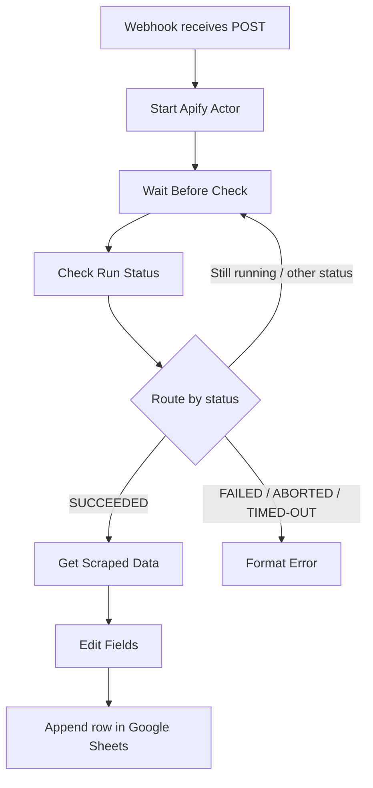

# LinkedIn Job Alert Automation with n8n and Apify

An n8n workflow template that starts an Apify LinkedIn jobs scraper, checks the actor run status, retrieves the resulting dataset after success, maps job fields, and appends the records to Google Sheets.

> **Important:** This repository contains a sanitized template based on the supplied n8n JSON export. It has not been live-executed or independently verified. Configure your own credentials and test with a small run before using it regularly.

## What it does

1. Receives a POST request through an n8n Webhook.
2. Starts the `curious_coder/linkedin-jobs-scraper` Apify actor.
3. Waits before checking the actor run status.
4. Routes successful runs to the dataset retrieval path.
5. Routes failed, aborted, or timed-out runs to an error-formatting node.
6. Routes other statuses back through a wait-and-check loop.
7. Maps job fields into a consistent structure.
8. Appends each scraped job record to a Google Sheets worksheet.

### Fields captured

- Job Title
- Company Name
- Location
- Posted Time
- Job URL
- Company URL

## Workflow diagram



Source: [`docs/workflow-diagram.mmd`](docs/workflow-diagram.mmd)

## Business use case

People searching for jobs often check job boards repeatedly and manually copy job details into a tracker. This workflow is intended to automate collection and logging of selected job listings into a spreadsheet, making it easier to review opportunities in one place.

This workflow is a collection-and-logging prototype. It does not currently perform relevance scoring, deduplication, personalized filtering, email alerts, or automatic applications.

## Technology stack

- n8n
- Apify actor API
- LinkedIn jobs search URL as scraper input
- Google Sheets

## Setup guide

### Prerequisites

- An n8n instance.
- An Apify account and API token.
- Access to the selected Apify scraper actor.
- Google Sheets OAuth credentials configured in n8n.
- A Google Sheet with these headers: `Job Title`, `Company Name`, `Location`, `Posted Time`, `Job URL`, `Company URL`.

### Import and configure

1. Import `workflow/linkedin-job-alert.template.json` into a test n8n workspace.
2. Add your own Apify API token to the `Start Apify Actor`, `Check Run Status`, and `Get Scraped Data` nodes using a secure credential or environment variable approach where supported. Do not commit tokens to Git.
3. Connect your own Google Sheets OAuth credentials.
4. Replace the spreadsheet URL and worksheet placeholder in `Append row in sheet`.
5. Replace `REPLACE_WITH_YOUR_LINKEDIN_JOBS_SEARCH_URL` with the LinkedIn job search URL you intend to collect.
6. Review the actor input schema. In particular, ensure `count`, `scrapeCompany`, `splitByLocation`, `splitCountry`, and `urls` match the actor's current documented inputs.
7. Confirm the status response path from Apify matches the expression used by `Route By Status`.
8. Run with a small count, such as 5, and inspect every node's output.
9. Verify that successful runs append expected records and failed runs are visible to the operator.
10. Activate the workflow only after testing and reviewing the relevant service terms and data-use requirements.

### Example webhook request body

```json
{
  "count": 5,
  "scrapeCompany": true,
  "splitByLocation": false,
  "splitCountry": "BD",
  "urls": [
    "REPLACE_WITH_YOUR_LINKEDIN_JOBS_SEARCH_URL"
  ]
}
```

Note: The supplied export's Apify actor input is configured in the HTTP Request node body, while the Webhook receives a request. The body is not currently mapped dynamically from the incoming webhook payload. If you want the webhook caller to control search URL/count, explicitly map and validate those fields.

## Output and evidence

After a successful run, the intended output is rows in Google Sheets with the six fields listed above.

Add screenshots from real executions:
1. n8n workflow overview.
2. Successful Apify actor run status.
3. Retrieved dataset output.
4. Google Sheets rows appended by the workflow.
5. Error path for a failed actor run.

See [`screenshots/README.md`](screenshots/README.md). Redact API tokens, private spreadsheet IDs, and account information.

## Testing checklist

See [`docs/test-plan.md`](docs/test-plan.md). At minimum, test successful, failed, aborted, timed-out, still-running, empty dataset, missing job fields, and Google Sheets write failures.

## Business impact

Potential benefits include less manual copying of job information and a repeatable job-tracking process. No measured time savings or job-search outcomes were provided, so this repository makes no numerical claims.

To measure impact, record:
- time needed to collect a fixed number of listings manually vs. using the workflow;
- number of valid records saved;
- duplicate rate;
- missing-field rate;
- run failure rate;
- number of relevant jobs after any later filtering step.

## Review findings and important fixes

These findings come from inspection of the supplied JSON, not a live run.

1. **Critical: an Apify API token is hard-coded in three HTTP Request nodes.** The template replaces it with a placeholder. If the token is real, revoke/rotate it and inspect account usage before publishing.
2. **The Google Sheet URL and spreadsheet ID are embedded.** They are replaced with placeholders in the public template.
3. **Webhook input is not used to configure the scraper.** The actor request body is fixed in the HTTP Request node, so sending different `count` or `urls` values to the webhook will not change the scrape unless expressions are added.
4. **The Wait node has no explicit wait duration in the export.** Configure a sensible delay and consider bounded polling with a maximum number of attempts.
5. **The workflow can poll repeatedly while the actor is still running.** Add a maximum retry count and a clear timeout path to prevent indefinite loops.
6. **The failed branch formats an error but does not send it to the webhook caller or an alert destination.** Add a Respond to Webhook node or a notification/logging step if callers need status feedback.
7. **Google Sheets append has no deduplication.** Repeated runs may append the same jobs multiple times. Consider a stable job ID or canonical Job URL check before appending.
8. **The saved actor input needs verification.** The original pinned data includes `scrapeCompany: "Python Developer"` and `splitByLocation: "Remote"`, which do not match the apparent intended boolean types. The sanitized template uses a clean, generic input, but you should confirm the actor's current schema.
9. **The status switch expects `data.status`.** Verify the actual Apify API response shape for your endpoint and node version.
10. **No live execution evidence was supplied.** Do not claim that the workflow has been tested successfully until you run it.

## Repository structure

```text
.
├── README.md
├── workflow/
│   └── linkedin-job-alert.template.json
├── docs/
│   ├── workflow-diagram.mmd
│   ├── test-plan.md
│   └── demo-script.md
├── examples/
│   └── sample-webhook-payload.json
└── screenshots/
    └── README.md
```

## License

Choose a license after confirming you have permission to publish the workflow. Never commit API tokens, private spreadsheet URLs, credentials, or private job-tracking data.
